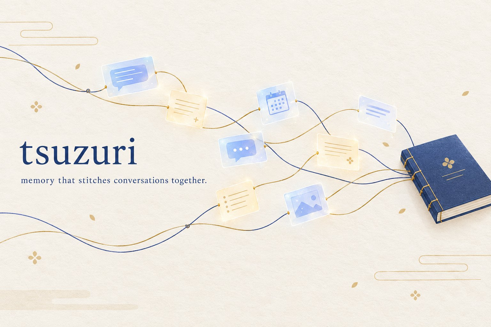

<p align="center">
  
</p>

<p align="center">
  <a href="docs/README.md">Documentation</a> ·
  <a href="examples/">Examples</a> ·
  <a href="docs/evaluation.md">Evaluation</a> ·
  <a href="README.zh-CN.md">中文</a> ·
  <a href="README.ja.md">日本語</a>
</p>

<p align="center">
  <a href="https://github.com/puresky271/tsuzuri/actions/workflows/ci.yml"></a>
  <a href="LICENSE"></a>
  
  
  
  
  
</p>

> [!NOTE]
> **tsuzuri is alpha (0.1).** APIs may change between minor versions. Prompts and text heuristics are **Chinese-first**: other languages store and recall fine, but extraction quality is tuned for Chinese.

## Introduction

tsuzuri (綴り, "stitching together") is a long-term memory layer and context compiler for products where several persistent characters talk with one user — one-on-one and in groups. It remembers what the user tells each character, decides what matters for the next reply, and compiles it into the prompt, so a character can ask *"how did Wednesday's interview go?"* a week later without you stuffing the whole history into context.

### Key features

**Core capabilities:**

- **Layered memory per agent**: working → episodic → semantic, plus procedural rules and a *collective* scope shared by the cast. Writes are rule-planned — an LLM never writes rows directly.
- **Recall**: a recency window, an FTS5 + jieba keyword lane and optional dense vectors, fused with ACT-R style decay, correction resolution and MMR. The pluggable `hybrid_v2` provider adds sparse vectors, structured slots and cross-encoder reranking for hosts that call it.
- **Turn facts**: every exchange becomes a fact card (facts, state changes, commitments, corrections, open threads). An explicit self-correction ("说错了，我的猫叫豆包") supersedes the earlier claim — reviewed by your LLM, or by rules offline — and retires the long-term rows written from it.
- **Context compiler**: selects, de-duplicates and budgets relevant facts, recalled memory and hearsay, and places a per-turn execution packet where the model attends most. Richer frames (world state, the user's ongoing states, conversation arc, evidence) are host-level compilers you fill with your application's state.
- **Consolidation ("dreaming")**: promote and decay, rethink semantic facts against new evidence, cluster episodes into event/topic narratives, rebuild a core summary and an entity projection, scan for forgetting — conservative by default (a shadow week for evolution, dry-run for destructive steps).
- **Multi-party memory**: rooms with speaker-attributed shared history, room-level fact cards, a shared collective scope, and hearsay that reaches other agents' prompts with decaying confidence. Confidential remarks ("先别告诉她") never enter the shared scope.

**Applications:**

- **Companion and character chat**: characters that keep promises, remember preferences and notice corrections.
- **Interactive fiction and games**: NPC casts that share news and remember the player across sessions.
- **Agent teams with a persistent user**: several assistants with separate memories plus a shared team memory.

## 🚀 Quickstart

| | Offline | With an LLM | Memory layer only |
|---|---|---|---|
| **Best for** | trying it, tests, CI | production chat | existing chat stack |
| **Needs** | nothing | any OpenAI-compatible endpoint | your own model call |
| **Fact extraction** | rule-based | LLM, with rule fallback | either |
| **Replies** | deterministic stand-in | your model | your model |
| **Consolidation** | rule steps only | full (rethink, clustering, summaries) | full |

### Install

```bash
git clone https://github.com/puresky271/tsuzuri.git && cd tsuzuri
pip install -e .                 # core: numpy, scipy, jieba
pip install -e ".[llm]"          # + OpenAI-compatible client
pip install -e ".[embeddings]"   # + dense recall (large model download)
pip install -e ".[dev]"          # + tests and lint
```

> [!NOTE]
> tsuzuri is not on PyPI yet; install from source. The API may change before 1.0.

> [!TIP]
> `tsuzuri demo` runs a scripted conversation, a recall check and a group room — no API key, no downloads.

### Basic usage

```python
from tsuzuri import Tsuzuri

memory = Tsuzuri("./.tsuzuri")                      # SQLite store + session files live here
memory.chat("林栖", "我下周三上午要去面试，有点紧张")
memory.chat("林栖", "对了，我不太能吃辣")

turn = memory.chat("林栖", "你还记得我下周三的面试吗？")
print(turn.reply)        # answered from the compiled workspace
print(turn.recalled)     # memory rows surfaced for this turn
print(turn.fact_card)    # the fact card extracted from this exchange
```

### With a model

```python
from tsuzuri import Tsuzuri, openai_compatible

llm, chat = openai_compatible(model="your-model", base_url="https://...", api_key="...")
memory = Tsuzuri("./.tsuzuri", llm=llm, reply=chat)
```

`llm` (`prompt -> str`) powers extraction, rethink and consolidation; `reply` (`messages -> str`) answers as the character. To keep your own stack, call `memory.build_messages(agent, text)` and send the messages yourself.

### Your own cast

```python
memory = Tsuzuri("./.tsuzuri", personas={
    "agents": ["Mira", "Juno"],
    "collective_scope": "crew",
    "collective_noun": "队伍",
    "aliases": {"Mira": ["Mira", "米拉"], "Juno": ["Juno", "朱诺"]},
    "user": {"name": "Sam", "pronoun": "TA"},
    "settings": {"persona_prompts": {"Mira": "你是米拉……", "Juno": "你是朱诺……"}},
})
```

Every key is in [docs/configuration.md](docs/configuration.md); [`examples/custom_cast.json`](examples/custom_cast.json) is a complete file.

### Group conversations

```python
room = memory.room(["林栖", "苏芮", "叶澄"], shared=True)
turn = room.say("周六我们一起去爬山吧，七点楼下集合")
for agent, reply in turn.replies:
    print(agent, reply)

room.share("苏芮", "阿澈下个月要去参加摄影比赛")   # hearsay for the other members
print(room.hearsay_for("叶澄"))
```

### Consolidation

```python
report = memory.dream("林栖")    # promote / decay / rethink / cluster / summarize
```

### CLI

```bash
tsuzuri demo                       # offline walkthrough
tsuzuri chat --agent 林栖 --llm     # interactive, uses LLM_MODEL / LLM_BASE_URL / LLM_API_KEY
tsuzuri recall "面试" --agent 林栖   # what would be recalled
tsuzuri dream --agent 林栖          # one consolidation cycle
tsuzuri eval                       # recall evaluation
```

## 📊 Evaluation

`tsuzuri eval` replays short synthetic histories in isolated stores and checks that the right information is visible to the model when it matters — preferences, plans, stable facts, corrections (newest value wins), per-agent isolation (private facts must not leak to another agent), shared rooms, speaker attribution, hearsay and multi-turn threads.

| Category | Offline, lexical recall | + dense embeddings (bge-small) |
|---|---|---|
| Preferences | 1/3 | 1/3 |
| Upcoming plans | 0/3 | 1/3 |
| Stable facts | 1/2 | 2/2 |
| Corrections (newest wins) | 1/2 | 1/2 |
| Isolation (no leak, owner still recalls) | 1/2 | 2/2 |
| Group rooms | 2/2 | 2/2 |
| Hearsay | 1/1 | 1/1 |
| Multi-turn threads | 0/1 | 1/1 |
| **Total** | **7/16 (44%)** | **11/16 (69%)** |

Bundled synthetic set v1, probes asked in a **new session** (no transcript, no session fact cards — only long-term memory can answer), rule-based extraction, no LLM. LLM extraction is not included in these numbers. Reproduce with `tsuzuri eval` and `tsuzuri eval --embeddings`.

> [!NOTE]
> The offline numbers measure lexical recall alone: a fact comes back when the question shares words with it ("面试" ↔ "面试"), not when it only shares meaning ("我下周三要做什么" ↔ "面试"). Dense embeddings and an LLM extractor close much of that gap; measure your own configuration on your own cases.

> [!WARNING]
> This is a 16-case *visibility* check (is the expected text in what the model reads?), not end-to-end answer accuracy, and it is not comparable to LoCoMo/LongMemEval scores. The persona prompt does not count, hearsay must reach the compiled context, and isolation cases also require the owner to recall the fact.

Format and methodology: [docs/evaluation.md](docs/evaluation.md).

### Known limitations

- **Natural follow-ups after a few days.** The surface plan is tuned to stay silent unless a memory is clearly relevant; without an explicit "do you remember…", a question three days later often grounds silently instead of surfacing the fact. Dense embeddings help; thresholds are not yet configurable per deployment.
- **Offline extraction is an echo.** Without an LLM, fact cards restate the user's line; commitments and open threads are not extracted, and room facts are not persisted to long-term memory (the room history still carries them).
- **One user per store.** Several engines can share a process, but calls are serialized and the schema has no tenant column.
- **No hard delete or export API yet.** Archiving and forgetting keep provenance; remove the data directory to erase a user's data.

## How it works

```
            ┌──────────────── one turn ────────────────┐
 user text ─┤ recall (hybrid)   turn facts   state      ├─▶ compile_fact_workspace
            │ conversation arc  evidence     packet     │      └─▶ assemble_workspace_messages ─▶ your LLM
            └───────────────────────────────────────────┘                                        │
 reply ◀────────────────────────────────────────────────────────────────────────────────────────┘
   └─▶ extract_turn_fact_card ─▶ session fact cards
   └─▶ MemoryCoreStore.append_turn_event ─▶ working / episodic / semantic / collective rows

 offline:  dream cycle ─▶ evolve · rethink · cluster · core summary · entities · forgetting scan
```

Details in [docs/architecture.md](docs/architecture.md).

## 🔗 Integrations

- **Any OpenAI-compatible LLM**: `tsuzuri.openai_compatible()` or your own `prompt -> str` / `messages -> str` callables.
- **Embeddings (optional)**: bge-small / bge-m3 via the `embeddings` extra for dense and sparse recall.
- **Host hooks**: give the engine your characters' full system prompts, canon facts, an OOC classifier, a message surface for reflections or your world state — all optional ([docs/hosting.md](docs/hosting.md)).

> [!IMPORTANT]
> Everything a user says may be stored under the data directory (`memory.db`, `sessions/`). Protect it like any personal data, keep API keys in the environment or an uncommitted `tsuzuri.toml`, and treat recalled text as untrusted model input.

## 📚 Documentation & support

- Docs: [docs/README.md](docs/README.md) — architecture, configuration, hosting, evaluation
- Questions and bugs: [GitHub issues](https://github.com/puresky271/tsuzuri/issues)
- Security: [SECURITY.md](SECURITY.md) · Contributing: [CONTRIBUTING.md](CONTRIBUTING.md) · Changelog: [CHANGELOG.md](CHANGELOG.md)

## Citation

```bibtex
@software{tsuzuri2026,
  title  = {tsuzuri: Long-term conversational memory and a context compiler for multi-agent character chat},
  author = {{tsuzuri contributors}},
  year   = {2026},
  version = {0.1.1},
  url    = {https://github.com/puresky271/tsuzuri},
  license = {Apache-2.0}
}
```

## ⚖️ License

Apache License 2.0 — see [LICENSE](LICENSE) and [NOTICE](NOTICE).
